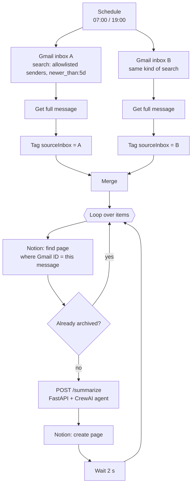

# Newsletter Speed Reader — email newsletters → structured summaries in Notion

Twice a day, a self-hosted n8n workflow pulls new newsletters from my inboxes, skips anything already archived, asks an LLM agent for a short structured summary, and files it in a Notion database I can search and filter by topic.

> **How this was built:** I am not a software engineer by background. I decided what to read, the summary format and the de-duplication rule; the workflow and the small API were built together with AI coding agents. This README focuses on design decisions and trade-offs.

| | |
|---|---|
| Trigger | n8n **Schedule** node, 07:00 and 19:00 (Asia/Taipei) |
| Mail source | Gmail (two inboxes), filtered by a **sender allowlist** search query, last 5 days, max 20 per inbox |
| Summarizer | Small **FastAPI** service wrapping one **CrewAI** agent ("Sam") on an **OpenAI** model, with a Pydantic output schema |
| Output | One page per newsletter in a **Notion** database (title, date, source, topics, summary, links) |
| Runs on | A small VPS: n8n in Docker, the API as a systemd service listening only on the Docker bridge |
| Status | In daily use. A transient Gmail connection error caused one failed run; retries were added to the Gmail and Notion nodes. |

## Flow



Workflow export: [`n8n/daily-newsletter-digest.workflow.json`](n8n/daily-newsletter-digest.workflow.json) · API: [`src/`](src/)

## How mail is selected

1. **Allowlist, not "everything in the inbox".** The Gmail search query lists the newsletter senders I actually want (`from:(a OR b OR …) newer_than:5d`). Personal mail never reaches the model.
2. **A 5-day look-back window** means a missed run (server restart, network error) is caught up by the next run instead of losing issues.
3. **De-duplication before the LLM call.** Each message's Gmail ID is looked up in the Notion database; only new IDs are summarised. This keeps the job idempotent and avoids paying for the same summary twice.
4. **One at a time with a short wait** between items, to stay polite to the Gmail/Notion APIs on a small server.

## Prompt design

The agent ([`src/agents/sam.py`](src/agents/sam.py), [`src/crews/newsletter_crew.py`](src/crews/newsletter_crew.py)):

- **Role**: a newsletter summary and business-insight specialist; **goal**: extract the core insight, key conclusions and topic tags.
- **No tools, no delegation, no memory**: it is pure text-in / structured-out, so behaviour is predictable.
- **Input**: subject, sender, date and the first 3,500 characters of the body.
- **Output enforced by a Pydantic model** (`output_pydantic`), so n8n always receives the same fields:

| Field | Rule |
|---|---|
| `title` | Precise title of the issue/article |
| `source` | Newsletter brand or publisher (may use the sender) |
| `date` | `YYYY-MM-DD`; falls back to the email date if the body has none |
| `topics` | 2–4 tags (Chinese/English mixed allowed) → Notion multi-select |
| `summary` | 3–5 sentences in Traditional Chinese, focused on insights and conclusions |
| `url` | Original link only if it is explicit in the body, otherwise empty |

A fictional example: [`examples/sample-input.json`](examples/sample-input.json) → [`examples/sample-output.json`](examples/sample-output.json). The output there is hand-written to show the schema, not captured from a live run; the `curl` command in the file regenerates it.

## Notion page format

Title · status (`summarised`) · issue date · source · original link · topics (multi-select) · summary · source inbox · Gmail ID (for de-duplication) · Gmail link.

## Run the API

```sh
python3 -m venv .venv && .venv/bin/pip install -r requirements.txt
cp .env.example .env          # add your own OPENAI_API_KEY
cd src && ../.venv/bin/python -m uvicorn api:app --host 127.0.0.1 --port 8000
curl -s http://127.0.0.1:8000/health
curl -s -X POST http://127.0.0.1:8000/summarize -H 'Content-Type: application/json' -d @../examples/sample-input.json
```

In production the service listens only on the Docker bridge address (see [`deploy/newsletter-api.service.example`](deploy/newsletter-api.service.example)), so the n8n container can reach it but nothing outside the host can. The model name is set in `src/agents/sam.py`; after changing it, call `/summarize` once — "service is active" does not prove the model string is valid.

To use the workflow: import the JSON into n8n, create Gmail and Notion credentials (removed from the export), and replace the placeholders listed in [`.env.example`](.env.example).

## Limits and trade-offs

- **Only the first 3,500 characters** of each email are summarised — cheap and fast, but long issues lose their second half.
- **De-duplication is per Gmail ID**, so the same newsletter subscribed in two inboxes becomes two pages.
- **The allowlist is maintained by hand** in the search query.
- **CrewAI for a single agent is heavyweight** (large dependency tree on a small VPS). It keeps the door open for multi-agent steps, but a direct API call would be lighter.
- **Verbose logging** in the agent can echo email text into the service log; turning it off is on the to-do list.
- One-off "backfill" variants of the workflow exist for importing older issues; they are not included here.
- Real newsletter content, sender lists and inbox addresses are intentionally not in this repo.

## Next steps

- Turn off verbose logging and log only message IDs and status.
- Cross-inbox de-duplication (e.g. by sender + subject + date).
- Summarise long issues in sections instead of truncating.
- A weekly digest page that groups summaries by topic.

---

## 中文摘要

自架 n8n 每天 07:00、19:00 執行：從兩個 Gmail 信箱以「寄件者白名單＋最近 5 天」搜尋電子報 → 以 Gmail ID 到 Notion 查重 → 只把新的信件交給 FastAPI＋CrewAI 的單一摘要 agent（OpenAI 模型，Pydantic 固定輸出欄位）→ 在 Notion 電子報資料庫建立頁面（標題、日期、來源、主題標籤、3–5 句繁中摘要、連結）。

設計取捨：白名單避免私人信件進入模型；查重放在呼叫模型之前，重跑不重複、不重複付費；只取內文前 3,500 字換取成本與速度。範例輸入為虛構電子報，範例輸出為說明格式用的手寫範例，非實際模型輸出。

我不是工程師出身；篩選規則、格式與查重設計由我決定，程式與 AI coding agent 協作完成。
